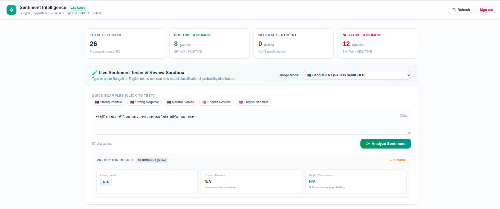
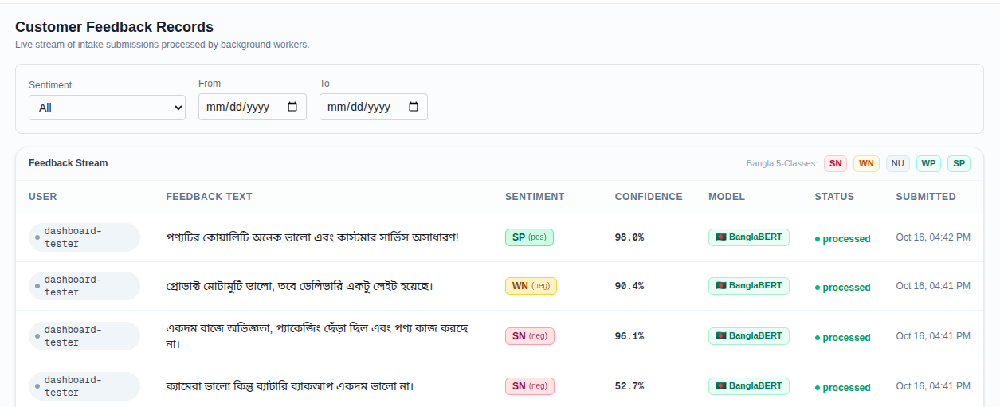
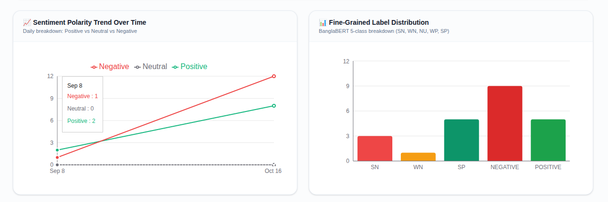
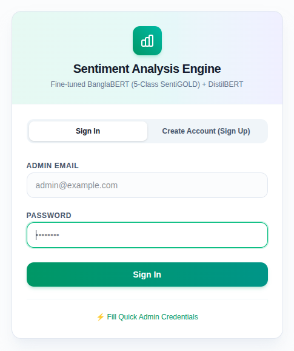

# ⚡ Multilingual Sentiment Intelligence Platform
### Fine-Tuned BanglaBERT (5-Class) & DistilBERT with Real-Time Worker Pipeline

[](https://fastapi.tiangolo.com)
[](https://nextjs.org)
[](https://huggingface.co/sm-khalil/banglabert-sentigold)
[](https://www.postgresql.org)
[](https://redis.io)
[](https://tailwindcss.com)

A production-grade, asynchronous customer feedback intake engine. Combines a fine-tuned **5-class BanglaBERT** model (`sm-khalil/banglabert-sentigold`) with **DistilBERT** (SST-2) for real-time multilingual sentiment classification, Redis/RQ queue worker execution, automated Slack alerts, and an interactive Next.js admin dashboard.

---

## 🔬 BanglaBERT Fine-Tuning & Results

The Bengali sentiment engine is powered by fine-tuning **`csebuetnlp/banglabert`** (ELECTRA architecture, 110M parameters) on **`SayedShaun/sentigold`** (~70,000 multi-domain Bengali texts across 30+ domains).

The full training and evaluation pipeline is documented in [`Banglabert_Fine_Tune.ipynb`](Banglabert_Fine_Tune.ipynb).

### 1. Training Setup
- **Base Model**: `csebuetnlp/banglabert` + Sequence Classification Head (5 output classes).
- **Preprocessing**: `csebuetnlp/normalizer` applied to sanitize Bengali Unicode, emojis, and punctuation.
- **Optimization**: AdamW, Learning Rate $2\times 10^{-5}$, Linear Warmup (10%), Weight Decay 0.01, Batch Size 32, FP16 on GPU.
- **Published Weights**: [`sm-khalil/banglabert-sentigold`](https://huggingface.co/sm-khalil/banglabert-sentigold) on Hugging Face.

### 2. Empirical Results (Test Set: 7,000 unseen samples)

Fine-tuning BanglaBERT yields a **+27.6% accuracy boost** and **+27.5% macro-F1 gain** over the baseline:

| Model Architecture | Accuracy | Macro F1 | Note |
|---|:---:|:---:|---|
| **TF-IDF + Logistic Regression** (Baseline) | 39.7% | 0.392 | Traditional ML baseline |
| **Fine-Tuned BanglaBERT** (Ours) | **67.3%** | **0.667** | **+27.6% boost over baseline** |

### 3. Class-Level Performance Breakdown

| Label | Bengali Description |/home/hamim/Downloads/Banglabert_Fine_Tune.ipynbk Precision | Recall | F1-Score | Support |
|---|---|:---:|:---:|:---:|:---:|
| **`SP`** | Strongly Positive (গাঢ় ইতিবাচক) | **0.721** | **0.763** | **0.741** | 1,532 |
| **`SN`** | Strongly Negative (গাঢ় নেতিবাচক) | **0.704** | **0.720** | **0.712** | 1,376 |
| **`NU`** | Neutral (নিরপেক্ষ) | **0.714** | **0.695** | **0.704** | 1,516 |
| **`WN`** | Weakly Negative (হালকা নেতিবাচক) | **0.612** | **0.602** | **0.607** | 1,368 |
| **`WP`** | Weakly Positive (হালকা ইতিবাচক) | **0.587** | **0.558** | **0.572** | 1,208 |

---

## 🖥️ Live Dashboard & System Screenshots

### 1. Live Sentiment Sandbox & Model Selector
Test real-time predictions with pre-built Bengali and English example chips, or manually pick the evaluation engine via the **Judge Model** dropdown:

<p align="center">
  
</p>

### 2. Customer Feedback Stream
Live streaming intake table showing fine-grained class badges (`SP`, `WN`, `SN`, `NU`), confidence percentages, model provenance (🇧🇩 BanglaBERT vs 🇬🇧 DistilBERT), and worker processing states:

<p align="center">
  
</p>

### 3. Real-Time Sentiment Analytics
Daily polarity trends (Positive vs Neutral vs Negative) alongside 5-class distribution histograms:

<p align="center">
  
</p>

### 4. Admin Auth & One-Click Login
JWT-authenticated admin portal with quick sign-up and auto-fill credentials:

<p align="center">
  
</p>

---

## 🏗️ Architecture

```
                       ┌─────────────────────────┐
                       │  Admin Web Dashboard     │ (Next.js 16 + Tailwind CSS)
                       │  http://localhost:3001   │
                       └────────────┬────────────┘
                                    │ JWT Bearer / REST
                                    ▼
   ┌──────────┐  POST /api/v1/feedback   ┌──────────────────────────┐
   │ Customer │ ────────────────────────▶│       FastAPI API        │
   └──────────┘                          │ (Rate limit, Idempotency)│
                                         └─────┬──────────────┬─────┘
                                               │              │
                                   Persist     ▼              ▼ Enqueue Job
                                   "pending" ┌────────────┐ ┌─────────────┐
                                             │ PostgreSQL │ │    Redis    │
                                             │  (Port     │ │  (RQ Queue) │
                                             │   5433)    │ └──────┬──────┘
                                             └─────▲──────┘        │ Dequeue
                                                   │               ▼
                                           Update  │     ┌───────────────────────┐
                                           Status  └─────│       ML Worker       │
                                                         │  Unified Engine:      │
                                                         │  ├─ 🇧🇩 BanglaBERT     │
                                                         │  │  (5-Class SentiGOLD│
                                                         │  └─ 🇬🇧 DistilBERT     │
                                                         └──────────┬────────────┘
                                                                    │ (SN/WN & conf >= threshold)
                                                                    ▼
                                                         ┌───────────────────────┐
                                                         │     Slack Alerts      │
                                                         └───────────────────────┘
```

### Key Capabilities
- **Lazy Singleton Engine**: Models and tokenizers are loaded once per worker process, keeping per-prediction latency under **150ms**.
- **Model Routing**: Text is automatically routed based on Bengali Unicode range (`U+0980`–`U+09FF`), or explicitly overridden via API/UI (`auto` | `bangla` | `distilbert`).
- **Resilient Fallback**: Automatic recovery ensures requests never hang indefinitely even if a remote model endpoint faces connectivity issues.
- **Automated Alerts**: Negative sentiment (`SN` or `WN`) with confidence exceeding threshold sends structured alerts to Slack.

---

## 🚀 Quickstart (Docker Compose)

### 1. Clone & Configure
```bash
git clone https://github.com/sm-khalil/sentimentAnalysis.git
cd sentimentAnalysis
cp .env.example .env
```
*(If your Hugging Face model repository is private, add your read token in `.env`: `HF_TOKEN=hf_...`)*

### 2. Run All Containers
```bash
docker compose up -d --build
```

### 3. Service Ports

| Service | URL | Description |
|---|---|---|
| **Admin Dashboard** | **[http://localhost:3001](http://localhost:3001)** | Next.js 16 UI with Live Sandbox & Analytics |
| **FastAPI Backend** | **[http://localhost:8000](http://localhost:8000)** | REST API with OpenAPI Docs at `/docs` |
| **PostgreSQL** | `localhost:5433` | Host port 5433 (maps to container 5432) |
| **Redis** | `localhost:6379` | RQ background job broker |

> **Quick Login**: Open [http://localhost:3001/login](http://localhost:3001/login) and click **"⚡ Fill Quick Admin Credentials"** to log in instantly.

---

## 📡 API Reference

Interactive Swagger docs are live at `http://localhost:8000/docs`.

### Submit Feedback
```bash
curl -X POST http://localhost:8000/api/v1/feedback \
  -H "Content-Type: application/json" \
  -d '{
    "user_id": "customer-101",
    "text": "পণ্যটির কোয়ালিটি অনেক ভালো এবং কাস্টমার সার্ভিস অসাধারণ!",
    "model_override": "auto"
  }'
```

### Example Worker Output
```json
{
  "id": "ee75744f-819f-4daa-b00b-87fc00304233",
  "status": "processed",
  "sentiment_label": "SP",
  "sentiment_polarity": "positive",
  "confidence": 0.9802,
  "probabilities": {
    "SP": 0.9802,
    "WP": 0.0133,
    "NU": 0.0028,
    "SN": 0.0024,
    "WN": 0.0011
  },
  "model_id": "sm-khalil/banglabert-sentigold",
  "model_revision": "df3f3ffcb6efe9d28791f2673d07218f1aea2d82"
}
```

---

## 🧪 Local Testing

Run unit & integration tests (uses mocked models for blazingly fast CI):

```bash
docker compose exec api pytest backend/tests -v
```

Frontend typecheck & linting:
```bash
cd frontend && npm run lint && npx tsc --noEmit
```

---

## 📁 Repository Layout

```
├── Banglabert_Fine_Tune.ipynb  # Kaggle/Colab notebook for BanglaBERT fine-tuning
├── screenshots/                # Dashboard & stream screenshots for documentation
├── backend/
│   ├── api/                    # FastAPI endpoints, auth, and rate limiters
│   ├── common/                 # SQLAlchemy models, schemas, and db config
│   ├── worker/                 # RQ worker tasks, sentiment engine & Slack notifier
│   └── tests/                  # Pytest test suite
├── frontend/
│   ├── src/app/                # Next.js App Router (Dashboard & Login pages)
│   ├── src/components/         # SentimentTester, FeedbackTable, Charts
│   └── src/lib/                # Auth context & SWR hooks
└── docker-compose.yml          # Container configuration for all 5 services
```
